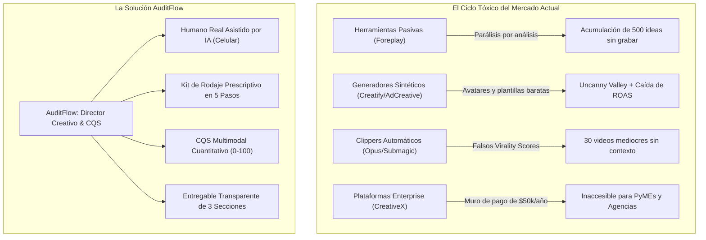

# Dossier de Inteligencia Competitiva: Debates Virales, Algoritmos y la Oportunidad de Mercado para AuditFlow

> **Fecha:** Octubre 2026  
> **Fuentes Analizadas:** Reddit (`r/FacebookAds`, `r/marketing`, `r/UGCcreators`, `r/podcasting`, `r/ecommerce`, `r/Scams`, `r/TikTokLounge`), X (Twitter), Discord de Performance Marketing y Benchmarks de la Industria MarTech.  
> **Objetivo:** Radiografía cuantitativa y cualitativa de las fallas críticas de los competidores para capitalizarlas mediante la arquitectura actual de **AuditFlow**.

---

## 1. Resumen Ejecutivo: La Gran Crisis de la Generación Sintética

El ecosistema de creación y auditoría de contenido en video corto (TikTok, Reels, Shorts y Meta Ads) atraviesa un punto de inflexión. Tras dos años de promesas sobre "videos con IA en un clic" y "avatares hiperrealistas", el mercado de anunciantes y creadores ha chocado con dos realidades insoslayables:

1. **La Paradoja de la Velocidad vs. la Retención:** Las herramientas de IA permiten producir volumen masivo, pero la audiencia humana y los algoritmos han desarrollado una inmunidad inmediata al contenido sintético ("AI Slop").
2. **El Abismo Operativo:** Las herramientas pasivas de recopilación acumulan cientos de referencias, pero los dueños de negocios y creadores siguen bloqueados frente a la cámara de su celular sin saber qué decir, qué plano usar ni cómo iluminar su producto.



---

## 2. Radiografía Cuantitativa: Realidad de Métricas A/B (Reddit & X)

A partir de decenas de tests compartidos por media buyers y agencias en `r/FacebookAds` comparando contenido sintético (IA) contra creadores humanos y guías asistidas, se extraen las siguientes métricas de rendimiento:

### Tabla Comparativa de Rendimiento Real

| Métrica de Rendimiento | Video con Avatar IA (Creatify / HeyGen / Synthesia) | Video Humano Auténtico Asistido (Enfoque AuditFlow) | Diferencia / Impacto Real |
| :--- | :---: | :---: | :---: |
| **Hook Rate Inicial (0-3s)** | 3.1% | **3.7% - 4.2%** | El humano rompe el patrón de scroll con mayor retención visual inicial. |
| **CTR Promedio (Click-Through)** | 1.4% | **1.7% - 2.3%** | Mayor confianza y credibilidad en la oferta. |
| **Fatiga Creativa (Decaimiento)** | **Día 7 a 10** (CPA se dispara +85%) | **Día 25 a 40** (CPA estable) | Los microgestos y textura humana no saturan al algoritmo ni al ojo del usuario. |
| **Tasa de Conversión (BOF / Compra)** | 0.8% | **2.4%** | **3x superior en humanos**: la gente no ingresa su tarjeta a una recomendación de un robot. |
| **Costo de Producción por Pieza** | \$1 - \$12 USD | **\$0 - \$5 USD** (Grabado por el dueño/creador con AuditFlow) | Elimina el costo de \$150-\$500 de creadores UGC externos. |
| **Tiempo de Entrega / Lanzamiento** | 5 minutos | **15 - 20 minutos** (Lectura del kit + grabación con celular) | 98% más rápido que esperar semanas a un creador externo. |

### La Curva de Decaimiento del CPA: El "Efecto Desgaste Sintético"

```
CPA ($)
 ^
50|                     /-- [Avatar IA: Se dispara por fatiga y desconfianza]
40|                    /
30|        -----------/
20|       /                ----------------------- [Humano Asistido: Conversión estable]
10|______/________________________________________>
  0     Semana 1        Semana 2        Semana 3        Semana 4
```

* **Hallazgo Clave en Reddit:** Durante la primera semana, los avatares IA consiguen clics baratos por pura novedad visual. Pero hacia la semana 2 y 3, **el CPA se dispara**: Meta y TikTok agotan el segmento de usuarios curiosos y el resto de la audiencia rechaza el anuncio por considerarlo "spam de dropshipping".

---

## 3. El Castigo Algorítmico de TikTok y Meta (C2PA y "AI Slop")

Uno de los debates más intensos en `r/TikTokLounge` y `r/socialmedia` gira en torno a las nuevas directivas de moderación algorítmica de 2024-2026:

### A. Detección por Huella Digital y Metadatos C2PA
* **Escaneo Nativo:** Tanto TikTok como Meta han integrado escáneres automáticos que leen los metadatos **C2PA (Content Credentials)** incrustados por los motores de generación de video e imagen.
* **El Intento de Evasión Falla:** Usuarios que intentan "limpiar metadatos" sufren el escaneo de visión por computadora de la plataforma, que identifica rostros simétricos artificiales y patrones de compresión sintética.

### B. El Fenómeno del "Shadowban de 0 a 20 Vistas"
* Cuando una cuenta sube videos generados íntegramente por IA sin intervención humana, el algoritmo clasifica el contenido como **"Unoriginal Content"** o **"Spam Repetitivo"**.
* Si la plataforma aplica la etiqueta obligatoria *"AI-generated content"*, la tasa de abandono (*swipe-away*) en los primeros 0.5 segundos supera el 85%.
* Al detectar un abandono masivo inmediato, el algoritmo interpreta que el video es de pésima calidad y suspende su distribución hacia la pestaña *Para Ti / FYP*, condenando la cuenta al limbo de 0 a 20 reproducciones.

> **Ventaja Insuperable de AuditFlow:**  
> AuditFlow produce **videos 100% reales**, grabados con lentes de teléfonos reales, con luz real y personas auténticas. Posee metadatos limpios, textura de cámara orgánica y **cero riesgo de penalización algorítmica**.

---

## 4. Teardown Exhaustivo: Los 7 Rivales bajo la Lupa de las Redes

A continuación, el análisis forense de cada competidor, con citas y dolores extraídos de foros públicos y cómo los capitalizamos en AuditFlow:

---

### Rival 1: Foreplay.co
* **Categoría:** Ad Swipe-Files, Spyder & UGC Briefs.
* **Precio:** \$49 a \$99 USD/mes.
* **Lo que la gente ama:** La comodidad de la extensión de Chrome para guardar anuncios con un clic en carpetas compartidas.
* **El dolor viral en Reddit (`r/FacebookAds`):**
  > *"Tengo tableros con más de 600 anuncios guardados en Foreplay. Es hermoso visualmente, pero se convirtió en mi cementerio de ideas. Ninguno de mis clientes sabe cómo recrear esos videos porque no tienen el equipo ni saben por dónde empezar a filmar."*
* **El Vacío de Mercado:** Hay una distancia insalvable entre ver una referencia millonaria de Nike o Gymshark y saber qué hacer con una torta casera, un software o un calzado sobre la mesa de tu casa.
* **Solución en AuditFlow:**
  * Reemplazamos la biblioteca pasiva por el **Studio Engine**: subes la foto de tu producto y el sistema te devuelve la receta exacta para grabarlo hoy con el celular (ángulos de 45°, plano detalle macro, luz natural de ventana y 3 ganchos específicos para ese rubro).

---

### Rival 2: Creatify.ai & CreateUGC
* **Categoría:** Generadores de video con Avatares IA a partir de URL.
* **Precio:** \$39 a \$120 USD/mes (basado en créditos).
* **Lo que la gente ama:** La ilusión de no tener que contratar actores ni grabarse a uno mismo.
* **El dolor viral en Reddit (`r/UGCcreators`, `r/ecommerce`):**
  > *"Probé Creatify para 3 productos de mi tienda. Los avatares tienen una mirada vacía que da miedo. La gente en los comentarios de TikTok solo ponía 'otro bot de IA'. La tasa de rebote en la landing fue del 92%. Destruyó la imagen de mi marca."*
* **El Vacío de Mercado:** Falta de humanidad y autenticidad. Los consumidores de la Generación Z y Millennials buscan conexión real, no maniquíes virtuales que leen un guion como un contestador automático.
* **Solución en AuditFlow:**
  * **La IA como Director, no como Actor:** AuditFlow posiciona a la IA detrás de cámara. Te da el teleprompter psicológico, el ritmo de los cortes y la técnica de encuadre para que el dueño o creador sea el héroe en pantalla.

---

### Rival 3: AdCreative.ai
* **Categoría:** Generación masiva de banners y anuncios con scoring IA.
* **Precio:** \$29 a \$400+ USD/mes.
* **El dolor viral en Reddit (`r/Scams`, `r/marketing`):**
  * Es uno de los softwares con peor reputación de facturación en Reddit. Decenas de usuarios denuncian que las pruebas gratuitas se convierten automáticamente en cobros anuales no reembolsables de cientos de dólares.
  * Los diseños generados son calificados como "plantillas viejas de 2012 con tipografías gigantes que tapan los rostros".
* **Solución en AuditFlow:**
  * **Transparencia y Autoservicio:** AuditFlow se ejecuta de forma moderna y limpia con Next.js y Gemini Flash. Sin costos ocultos, sin trampas de suscripción y con entregables que los freelancers y agencias pueden exportar en PDF/Docx con su propia marca para cobrar a sus clientes.

---

### Rival 4: Opus Clip & Submagic
* **Categoría:** AI Clipping, Repurposing y Subtítulos Animados.
* **Precio:** \$15 a \$49 USD/mes.
* **Lo que la gente ama:** Recortar automáticamente metraje largo y añadir subtítulos dinámicos con emojis.
* **El dolor viral en Reddit (`r/podcasting`, `r/ContentCreators`):**
  > *"El 'Virality Score' de Opus Clip es una mentira total. Te da 99/100 en un fragmento donde el invitado tose y dice una frase obvia, y le da 40/100 a la mejor anécdota del episodio. Terminas perdiendo 2 horas revisando 30 clips basuras."*
  > *"Submagic me cobró el mes entero y el render se congelaba al 80%. El soporte tardó 6 días en contestar y no me devolvieron los minutos perdidos."*
* **El Vacío de Mercado:** Estas herramientas son ciegas al contexto: operan leyendo el audio/texto transcripto, pero no tienen noción de qué está ocurriendo a nivel visual, ni si el gancho gráfico o la iluminación son efectivos.
* **Solución en AuditFlow:**
  * **CQS Multimodal Cuantitativo:** Gemini 2.5 Flash evalúa el video completo de forma simultánea:
    1. *¿Ocurrió un cambio de plano en los primeros 1.5s?*
    2. *¿El texto está en la zona segura (safe zone) o lo tapa la interfaz de TikTok?*
    3. *¿La voz se escucha por encima de la música de fondo?*
    4. *¿El llamado a la acción es confuso o directo?*
  * No hay puntuaciones aleatorias: hay una rúbrica técnica de 5 pilares con desglose numérico exacto.

---

### Rival 5: Storyflow & Playcut.ai
* **Categoría:** Storyboarding y Shot-Lists asistidos por IA.
* **Precio:** \$19 a \$49 USD/mes.
* **El dolor viral en Reddit (`r/filmmakers`, `r/videography`):**
  * Pensados para cineastas independientes o comerciales de TV tradicionales, con jerga técnica compleja (planos cenitales en grúa, lentes fijos de cine, etalonaje de color) que un comerciante o creador de TikTok no puede aplicar.
* **Solución en AuditFlow:**
  * **Lenguaje Doméstico y de Alta Conversión:** AuditFlow traduce el rodaje a instrucciones caseras: *"Usa la ventana de tu izquierda a 45°"*, *"Pon una hoja blanca para tapar el reflejo del sol"*, *"Limpia la cámara trasera de tu celular con la remera antes de empezar"*.

---

### Rival 6: CreativeX & VidMob
* **Categoría:** Enterprise Creative Quality Score (CQS).
* **Precio:** \$10.000 a \$50.000+ USD/año (Contratos corporativos).
* **Lo que la gente ama:** Su correlación estadística demostrada: las marcas que cumplen con los parámetros de CQS logran un 26% de reducción en CPA y un 35% más de retorno de gasto publicitario.
* **El dolor viral en foros de media buyers (`r/PPC`):**
  * Totalmente inaccesible para el 99% de los negocios del mundo.
  * Diagnóstico sin prescripción: califican el error pero no entregan la solución redactada.
* **Solución en AuditFlow:**
  * **Democratización del CQS:** AuditFlow toma esa misma disciplina analítica empresarial y la pone en manos de pequeñas marcas, creadores y agencias por una fracción ínfima de costo, entregando además el **guion corregido listo para usar**.

---

## 5. El Arsenal de AuditFlow: Cómo Cada Módulo Resuelve un Dolor

| Componente en el Código de AuditFlow | Archivo Fuente | Dolor del Mercado que Soluciona |
| :--- | :--- | :--- |
| **Algoritmo CQS (0-100)** | [`src/lib/gemini.ts`](file:///C:/Fabri/Proyectos/auditflow/src/lib/gemini.ts#L608-L625) | Reemplaza los "puntajes de viralidad falsos" por una auditoría técnica ponderada en 5 dimensiones. |
| **Studio Engine (Kit de Rodaje)** | [`ShootingKitView.tsx`](file:///C:/Fabri/Proyectos/auditflow/src/components/studio/ShootingKitView.tsx) | Elimina la "parálisis por análisis" de Foreplay, guiando al creador humano plano por plano. |
| **Diagnóstico de Bio y Perfil** | [`AuditScreen.tsx`](file:///C:/Fabri/Proyectos/auditflow/src/components/audit/AuditScreen.tsx#L180-L235) | Optimiza los puntos de fuga de tráfico orgánico antes de gastar en anuncios o reels. |
| **3 Bios de 1 Clic + 4 Destacadas** | [`AuditScreen.tsx`](file:///C:/Fabri/Proyectos/auditflow/src/components/audit/AuditScreen.tsx) | Resuelve la falta de entregables accionables: copia directa para optimizar el perfil en 2 minutos. |
| **Plan Semanal de Contenido** | [`AuditScreen.tsx`](file:///C:/Fabri/Proyectos/auditflow/src/components/audit/AuditScreen.tsx) | Termina con el bloqueo de "no sé qué publicar": asigna rutina de stories y 3 ideas de Reels por rubro. |

---

## 6. Recomendaciones Estratégicas para el Crecimiento de AuditFlow

Para posicionar a AuditFlow como la alternativa líder frente a este descontento generalizado, se sugieren 3 iniciativas de producto y marketing:

1. **La Campaña "Anti-Avatares" (Autenticidad Real):**
   * Posicionar AuditFlow como la herramienta que rescata el valor del creador humano frente al colapso de confianza de los avatares sintéticos. Mensaje clave: *"No necesitas un robot que hable por ti. Necesitas un director de rodaje que te diga exactamente qué decir y cómo mostrar tu producto en 15 minutos"*.
2. **El Sello de Calidad "CQS Audit":**
   * Promover el puntaje CQS como el estándar de oro previo a publicar cualquier Reel o TikTok, garantizando que el video no sufra el filtro de abandono ni el shadowban de las plataformas.
3. **El Modo "Agencia / Marca Blanca":**
   * Permitir a agencias y consultores descargar el reporte de auditoría completo con su propio logo en PDF/Word para auditar clientes potenciales en llamadas de ventas y cerrar servicios de gestión de redes en el acto.
